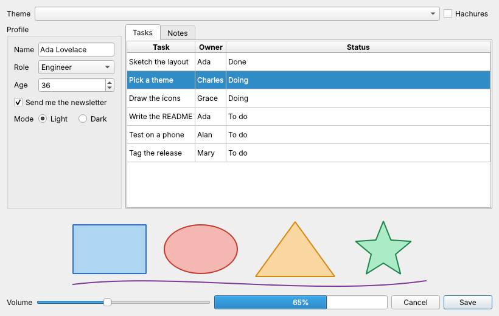
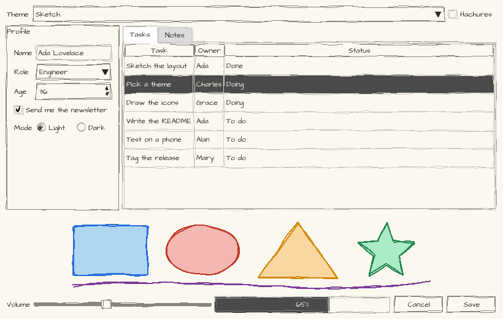
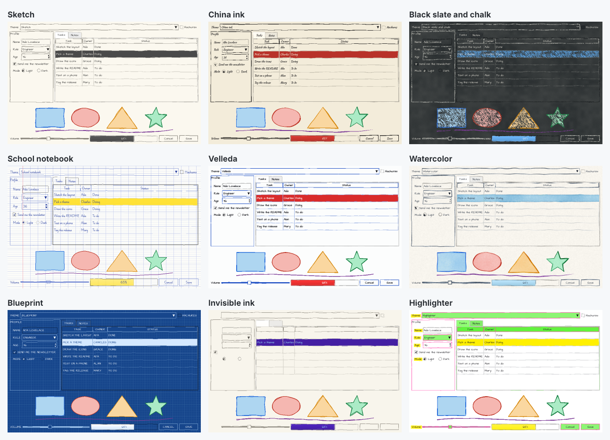
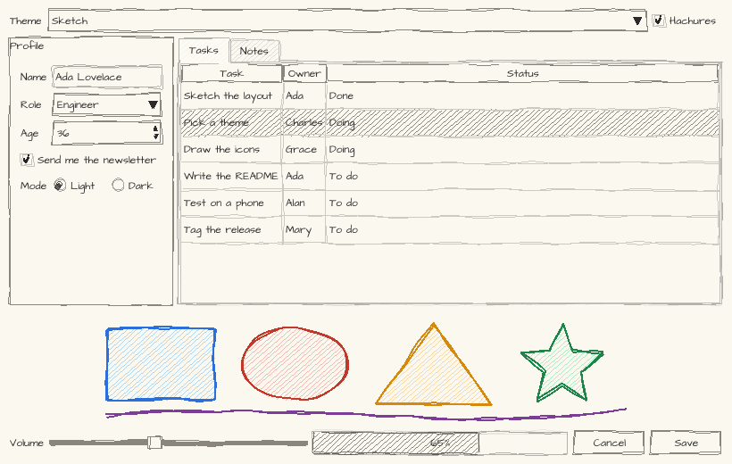
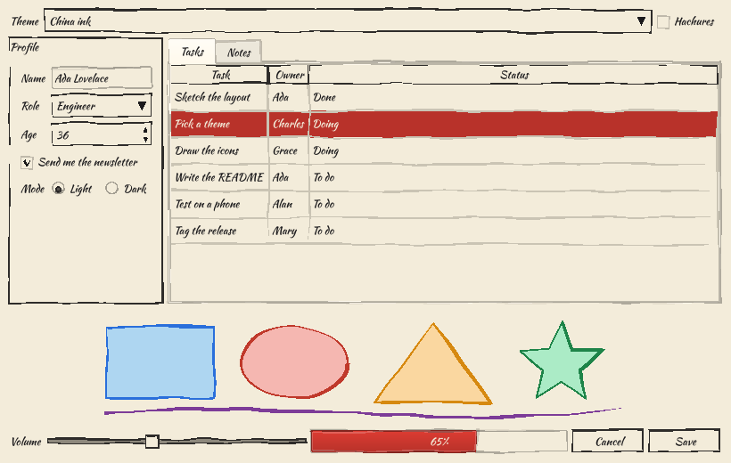
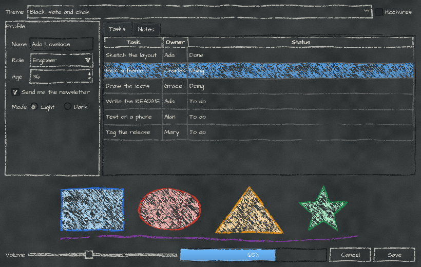
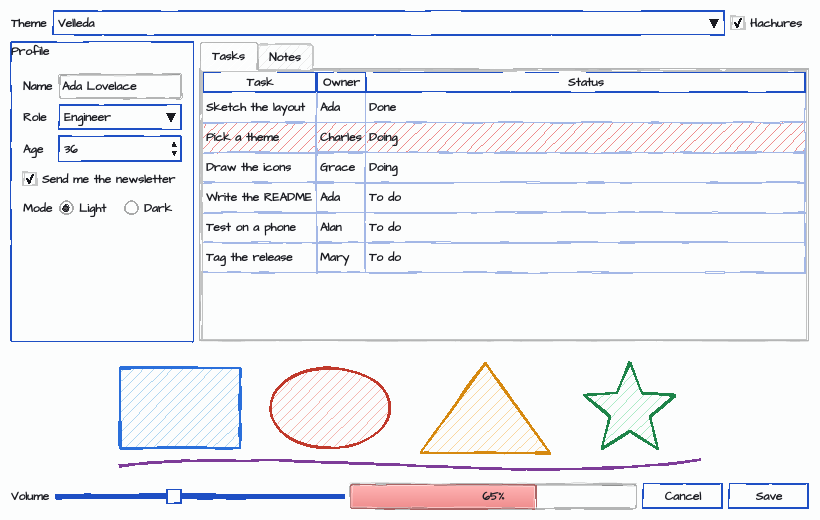
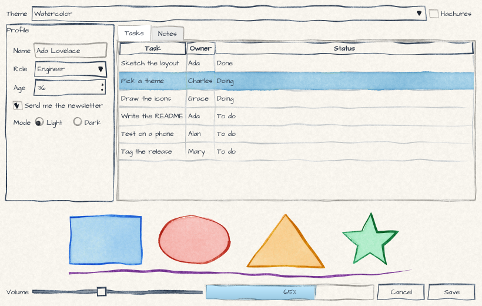
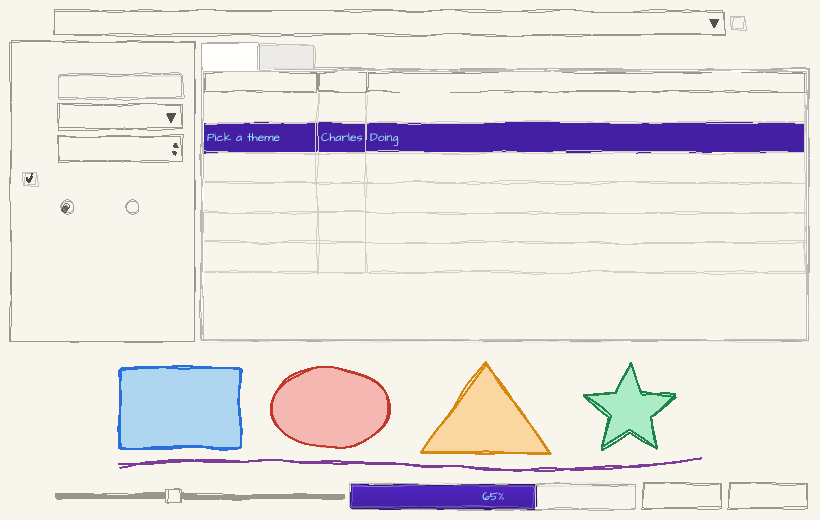
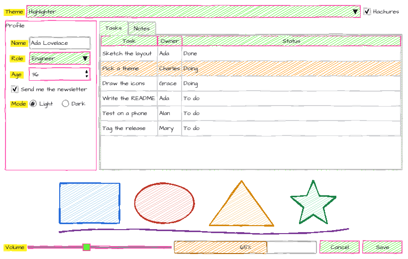

<h1 align="center">
  <picture>
    <source media="(prefers-color-scheme: dark)" srcset="docs/logo/logo-dark.png">
    
  </picture>
</h1>

<p align="center">
  <a href="https://github.com/qnope/HandPaintingForQt/actions/workflows/ci.yml"></a>
  <a href="https://qnope.github.io/HandPaintingForQt/"></a>
  <a href="https://github.com/qnope/HandPaintingForQt/releases"></a>
  <a href="LICENSE"></a>
</p>

Hand Painting for Qt (hpq) is a C++ library that gives the widgets of a Qt application a
hand-drawn look, à la [Rough.js](https://roughjs.com). One call themes a window and every widget
in it:

```cpp
#include <hpq/Hpq.h>

MainWindow window;
hpq::apply_theme(window, hpq::sketch_theme());
window.show();
```

The same window, as Qt draws it and after this call:

<p align="center">
  
  
</p>

The widgets keep their behavior, and what your own code paints with `QPainter` is drawn by hand
too. There are nine themes: pencil sketch, China ink, chalk on a slate, school notebook,
whiteboard markers, watercolor, blueprint, invisible ink and highlighter.

You can try them in your browser: https://qnope.github.io/HandPaintingForQt/

[](https://qnope.github.io/HandPaintingForQt/teaser.mp4)

The teaser in 1080p: [teaser.mp4](https://qnope.github.io/HandPaintingForQt/teaser.mp4).

## Contents

- [Features](#features)
- [Quick start](#quick-start)
- [Themes](#themes)
- [Paint by hand with QPainter](#paint-by-hand-with-qpainter)
- [Use hpq in your project](#use-hpq-in-your-project)
- [Examples](#examples)
- [API overview](#api-overview)
- [Build, test and contribute](#build-test-and-contribute)
- [Versions and changelog](#versions-and-changelog)
- [License](#license)

## Features

- Nine themes, each with a solid or a hatched fill.
- The standard widgets are drawn by hand: buttons, check boxes, radio buttons, line edits, combo
  boxes, spin boxes, sliders, scroll bars, progress bars, tabs, group boxes, tables, trees and
  headers. So are the menus, dialogs, tooltips and lists that open as windows of their own.
- Your own painting is drawn by hand too: the `paintEvent` of your widgets and the items of a
  `QGraphicsScene` take the theme without a change to their code.
- The hand is steady. A shape keeps its wobble between repaints and when a view scrolls. A theme
  draws the same window every time, and another seed gives it another hand.
- Repaints are fast. The rough paths of the shapes are kept between repaints, and a repaint of
  a part of a window (a hovered button, the cursor of a field) draws only what is close to it.
- The handwritten fonts of the themes are embedded in the library.
- It runs where Qt runs: a shared library on Windows (MSVC), Linux (gcc, clang) and macOS
  (clang), a static one with Qt for WebAssembly.
- It is one CMake target, `hpq::hpq`, that you get with `FetchContent`, `add_subdirectory` or
  `find_package`.

## Quick start

You need Qt 6 with the Widgets module, a C++17 compiler and CMake 3.16 or newer.

In your `CMakeLists.txt`, let CMake download hpq and build it with your application:

```cmake
find_package(Qt6 REQUIRED COMPONENTS Widgets)

include(FetchContent)
FetchContent_Declare(HandPaintingForQt
  GIT_REPOSITORY https://github.com/qnope/HandPaintingForQt.git
  GIT_TAG v0.2.0
  GIT_SHALLOW TRUE)
FetchContent_MakeAvailable(HandPaintingForQt)

qt_add_executable(MyApplication main.cpp)
target_link_libraries(MyApplication PRIVATE Qt6::Widgets hpq::hpq)
```

In your `main.cpp`, make a theme and give it to the window:

```cpp
#include <hpq/Hpq.h>

#include <QApplication>

int main(int argc, char *argv[]) {
    QApplication application(argc, argv);
    MainWindow window;

    const hpq::Theme theme = hpq::sketch_theme();

    // The window and every widget in it.
    hpq::apply_theme(window, theme);

    // Menus, dialogs and tooltips are windows of their own: this event filter gives them the
    // theme when they open.
    hpq::WindowTheming window_theming(theme);
    application.installEventFilter(&window_theming);

    window.show();
    return application.exec();
}
```

`apply_theme` themes the widgets that the window has when you call it. Call it once they are
built (after `setupUi`), and again after you add widgets. Calling it with another theme switches
the theme, and `hpq::remove_theme(window)` gives the window back its original look.

The other ways to get hpq, and the notes for Windows and macOS, are in
[Use hpq in your project](#use-hpq-in-your-project).

## Themes



Each theme is a function of `<hpq/Themes.h>`. It takes the fill style,
`hpq::FillStyle::Solid` (the default) or `hpq::FillStyle::Hachure`, and returns a `hpq::Theme`.
A theme is a plain value: change the fields that you want before you apply it.

```cpp
hpq::Theme theme = hpq::watercolor_theme(hpq::FillStyle::Hachure);
theme.rough_options.roughness = 0.5;                             // a steadier hand
theme.rough_options.seed = std::random_device()();               // another hand at each run
theme.antialiasing_mode = hpq::AntialiasingMode::OnlyWhenAsked;  // smooth as Qt does
hpq::apply_theme(window, theme);
```

The seed is the hand that draws. It is 0 unless you change it, so a theme draws the same window
at every run.

By default every line and every fill is smoothed. `Theme::antialiasing_mode` chooses between
`hpq::AntialiasingMode::Always` (the default), `OnlyWhenAsked` (where the painter asks for it
with `QPainter::Antialiasing`, as Qt draws) and `Never`. Smoothing costs time: a full repaint of
a window can take 2 to 3 times longer, and a hovered button stays well under a millisecond.

| Theme | Solid | Hachures |
| --- | --- | --- |
| **Sketch**<br>`sketch_theme`<br><br>Graphite pencil on paper. |  |  |
| **China ink**<br>`china_ink_theme`<br><br>A brush loaded with ink on rice paper, and the red of a seal for the selection. |  |  |
| **Black slate and chalk**<br>`slate_theme`<br><br>White and colored chalk on a black slate. |  |  |
| **School notebook**<br>`notebook_theme`<br><br>A fountain pen on the Seyès ruled paper of a French school notebook. |  |  |
| **Velleda**<br>`velleda_theme`<br><br>Dry-erase markers on a white board. |  |  |
| **Watercolor**<br>`watercolor_theme`<br><br>Washes and brush lines on a grainy paper. |  |  |
| **Blueprint**<br>`blueprint_theme`<br><br>White ink on the blue paper of an architect, with a faint grid. |  |  |
| **Invisible ink**<br>`invisible_ink_theme`<br><br>The text shows only where it is selected, under the violet light of a lamp. |  |  |
| **Highlighter**<br>`highlighter_theme`<br><br>Fluorescent highlighters over notes in black pen. |  |  |

The images are the window of [`Examples/Integration`](Examples/Integration), rendered by
[`tools/screenshots`](tools/screenshots/ThemeScreenshots.cpp).

## Paint by hand with QPainter

In a themed window, the `paintEvent` of your widgets is drawn by hand without a change. Outside
of the widgets, `hpq::HandPaintDevice` does the same for any `QPainter`, on a `QImage` for
instance:

```cpp
QImage image(400, 300, QImage::Format_ARGB32_Premultiplied);
image.fill(Qt::white);
QPainter target(&image);
hpq::HandPaintDevice device(target, hpq::sketch_theme());

QPainter painter(&device);
painter.setPen(QPen(QColor("#2a6fdb"), 2));
painter.setBrush(QColor("#aed6f1"));
painter.drawEllipse(50, 50, 300, 200);
```

The logo at the top of this page is drawn this way, by [`tools/logo`](tools/logo/LogoDrawing.h):
the same drawing with the sketch theme on a light page, and with the slate theme on a dark one.

## Use hpq in your project

The requirements are Qt 6 with the Widgets module (the CI uses Qt 6.8, and Qt 6.4 works too), a
C++17 compiler and CMake 3.16 or newer.

There are three ways to get hpq. In each of them your application links the same target,
`hpq::hpq`, which brings the headers, C++17 and `Qt6::Widgets`:

```cmake
find_package(Qt6 REQUIRED COMPONENTS Widgets)
# ... get hpq in one of the three ways below ...
qt_add_executable(MyApplication main.cpp)
target_link_libraries(MyApplication PRIVATE Qt6::Widgets hpq::hpq)
```

[`Examples/Integration`](Examples/Integration/CMakeLists.txt) is a complete application that
does it in each of the three ways. The CI builds it and runs it on every platform.

### With FetchContent

CMake downloads the release and builds hpq with your application, as in the
[quick start](#quick-start):

```cmake
include(FetchContent)
FetchContent_Declare(HandPaintingForQt
  GIT_REPOSITORY https://github.com/qnope/HandPaintingForQt.git
  GIT_TAG v0.2.0
  GIT_SHALLOW TRUE)
FetchContent_MakeAvailable(HandPaintingForQt)
```

As a subproject, HandPaintingForQt builds only the library: its tests, examples and tools are
off, and it does not need GoogleTest. To build it from a copy that you already have, configure
with `-DFETCHCONTENT_SOURCE_DIR_HANDPAINTINGFORQT=<path of the copy>`.

### With add_subdirectory

With a copy of the repository in your project, as a git submodule for instance:

```cmake
add_subdirectory(external/HandPaintingForQt)
```

### With find_package, after an install

Build and install hpq once:

```sh
cmake -S HandPaintingForQt -B build/hpq -DCMAKE_BUILD_TYPE=Release \
      -DHPQ_BUILD_TESTS=OFF -DHPQ_BUILD_EXAMPLES=OFF -DCMAKE_PREFIX_PATH=<qt>
cmake --build build/hpq --config Release
cmake --install build/hpq --config Release --prefix <prefix>
```

Then find it in your project, with `<prefix>` in `CMAKE_PREFIX_PATH`
(`-DCMAKE_PREFIX_PATH="<prefix>;<qt>"`):

```cmake
find_package(HandPaintingForQt 0.2 REQUIRED)
```

The package finds Qt itself. Before 1.0, `find_package(HandPaintingForQt 0.2)` accepts the
versions 0.2.x only, because a minor version may change the API.

The install holds:

| Path | Content |
| --- | --- |
| `include/hpq/` | The headers, with the generated `hpq/Version.h` |
| `lib/libhpq.so.0.2.0`, `lib/libhpq.0.2.0.dylib`, `bin/hpq.dll` and `lib/hpq.lib` | The library (`hpqd.dll` and `hpqd.lib` in Debug with MSVC, so that a Debug and a Release build can share a prefix) |
| `lib/cmake/HandPaintingForQt/` | The CMake package: `HandPaintingForQtConfig.cmake`, its version file and the target `hpq::hpq` |
| `share/doc/HandPaintingForQt/` | The license of hpq and those of its fonts |

On Linux, the installed library finds Qt where it was linked with it (its RPATH).

### On Windows

Windows has no RPATH: the application loads `hpq.dll` from its own directory or from `PATH`.
Copy it next to the executable after the build, as `Examples/Integration` does:

```cmake
if(WIN32)
  add_custom_command(TARGET MyApplication POST_BUILD
    COMMAND ${CMAKE_COMMAND} -E copy_if_different $<TARGET_FILE:hpq::hpq> $<TARGET_FILE_DIR:MyApplication>
    VERBATIM)
endif()
```

With `FetchContent` or `add_subdirectory`, setting `CMAKE_RUNTIME_OUTPUT_DIRECTORY` in your
project also builds `hpq.dll` in the directory of your executables. To ship the application,
`windeployqt` copies Qt next to it.

### On macOS with Qt 6.8 and Xcode 26

This is not an issue of hpq, but you may meet it: Qt 6.8 links the AGL framework, which the
macOS SDK of Xcode 26 no longer has, and the link fails with `framework 'AGL' not found`. Before
`find_package(Qt6)`, link the OpenGL framework in its place, as this project and
`Examples/Integration` do:

```cmake
if(APPLE)
  execute_process(COMMAND xcrun --show-sdk-path
    OUTPUT_VARIABLE sdk OUTPUT_STRIP_TRAILING_WHITESPACE ERROR_QUIET)
  if(NOT EXISTS "${sdk}/System/Library/Frameworks/AGL.framework")
    set(WrapOpenGL_AGL "-framework OpenGL")
  endif()
endif()
```

### Options

| Option | Default | Effect |
| --- | --- | --- |
| `HPQ_BUILD_TESTS` | `ON`, `OFF` in a subproject | The tests (GoogleTest, from vcpkg) |
| `HPQ_BUILD_EXAMPLES` | `ON`, `OFF` in a subproject | The example application and the tools that render the logo, the screenshots and the teaser |
| `HPQ_INSTALL` | `ON` | The install rules and the CMake package |
| `HPQ_BUILD_BENCH` | `OFF` | The repaint benchmark ([`bench`](bench/README.md)), with the examples |

### Version

`<hpq/Version.h>` gives the version that the code is compiled with (`HPQ_VERSION_MAJOR`,
`HPQ_VERSION_MINOR`, `HPQ_VERSION_PATCH`, `HPQ_VERSION_STRING`), and `hpq::version()`
(`<hpq/Hpq.h>`) the version of the library loaded at run time.

## Examples

- [`Examples/Integration`](Examples/Integration) is a small application, a separate CMake project
  as yours is, with a gallery of widgets and of shapes painted in `paintEvent`, and a combo box
  to change the theme. `GALLERY_HPQ_SOURCE` chooses how it gets hpq: `find_package` (the
  default), `FetchContent` or `add_subdirectory`.

  ```sh
  cmake -S Examples/Integration -B build/gallery -DGALLERY_HPQ_SOURCE=add_subdirectory -DCMAKE_PREFIX_PATH=<qt>
  cmake --build build/gallery
  ```

- [`Examples`](Examples) is the example application of the repository, built with it, and the
  one that [runs in the browser](https://qnope.github.io/HandPaintingForQt/): a table, a tree, a
  `QGraphicsScene` of shapes, menus and a dialog, and settings to choose the theme, its fill and
  where it smooths.

## API overview

All of hpq is in the namespace `hpq`, and `<hpq/Hpq.h>` includes all of it.

| Header | What it gives |
| --- | --- |
| `<hpq/Themes.h>` | The nine themes: `sketch_theme`, `china_ink_theme`, `slate_theme`, `notebook_theme`, `velleda_theme`, `watercolor_theme`, `blueprint_theme`, `invisible_ink_theme` and `highlighter_theme`. Each returns a `Theme`. |
| `<hpq/Theming.h>` | `apply_theme(window, theme)` and `remove_theme(window)` theme a window and its widgets, or give them back their look. `WindowTheming` is the event filter that themes the menus, dialogs and tooltips of the application. |
| `<hpq/Theme.h>` | `Theme`, a struct, to change a theme or to make one of your own. Its fields are a `QPalette`, a `QFont`, `RoughOptions` (roughness, number of strokes, largest offset, gap and angle of the hachures, and the seed of the hand), a `FillStyle`, a `Medium` (`Pencil`, `Chalk`, `Ink` or `Watercolor`), a `TextInk` (`Visible` or `Invisible`), the marker of the labels and an `AntialiasingMode`. |
| `<hpq/HandPaintDevice.h>` | `HandPaintDevice` hand-paints what a `QPainter` draws, outside of the widgets. See [Paint by hand with QPainter](#paint-by-hand-with-qpainter). |
| `<hpq/HandPaintEffect.h>` | `HandPaintEffect`, the `QGraphicsEffect` that hand-paints a widget and its children, for a single widget. |
| `<hpq/HandPaintStyle.h>` | `HandPaintStyle`, the `QStyle` that `apply_theme` gives to each widget. |
| `<hpq/RoughGeometry.h>` | `rough_outline`, `rough_frame_outline`, `rough_fill_area` and `rough_hachure`: how shapes are made rough, as four functions of a shape, of `RoughOptions` and of the seed of the shape. The same seed draws the same paths every time. |
| `<hpq/PaintCache.h>` | `PaintCache` keeps the rough paths of the shapes between repaints. A `HandPaintEffect` has one, and a `HandPaintDevice` can be given one. |
| `<hpq/Version.h>` | The version that the code is compiled with. |

What `apply_theme` does is a palette and a font on the window, a `HandPaintStyle` on each
widget and a `HandPaintEffect` on the window.

An application written for hpq 0.1 moves to 0.2 with the table at the top of the
[changelog](CHANGELOG.md).

## Build, test and contribute

With Qt, and vcpkg next to the repository (`../vcpkg`) for GoogleTest:

```sh
cmake -S . -B build -DCMAKE_TOOLCHAIN_FILE=../vcpkg/scripts/buildsystems/vcpkg.cmake -DCMAKE_PREFIX_PATH=<qt>
cmake --build build --config Debug
ctest --test-dir build -C Debug --output-on-failure
```

[CONTRIBUTING.md](CONTRIBUTING.md) tells the rest: the presets, the WebAssembly build and its
site, how the images, the logo and the teaser of this page are rendered, and how a version is
published.

## Versions and changelog

hpq follows [Semantic Versioning](https://semver.org): before 1.0, a minor version (0.1 to
0.2) may change the API and the ABI, a patch version does not. The changes of each version are
in [CHANGELOG.md](CHANGELOG.md).

## License

Hand Painting for Qt is under the [MIT license](LICENSE).

The fonts embedded in the library are under the [SIL Open Font License 1.1](hpq/resources/fonts):
[Architects Daughter](hpq/resources/fonts/OFL.txt),
[Playwrite FR Moderne](hpq/resources/fonts/OFL-PlaywriteFRModerne.txt) and
[Kaushan Script](hpq/resources/fonts/OFL-KaushanScript.txt).
