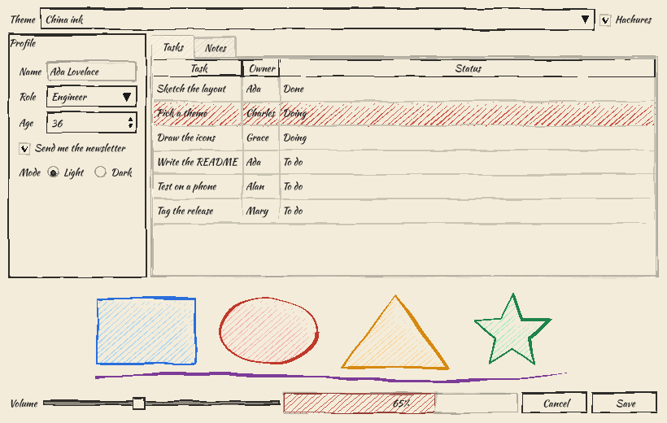
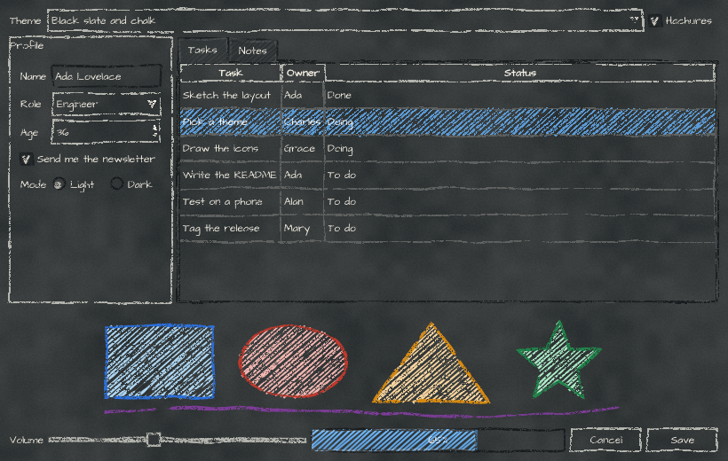
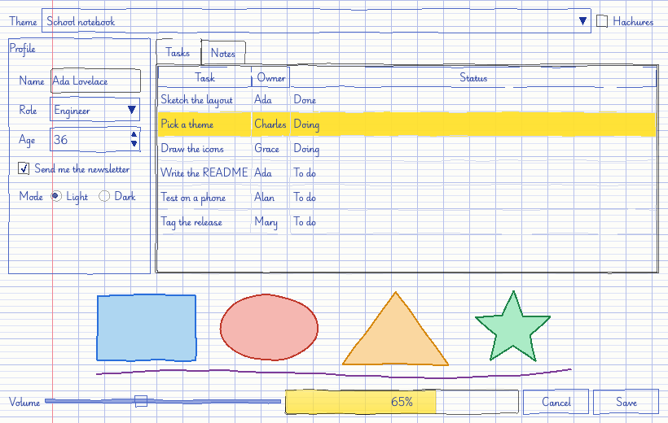
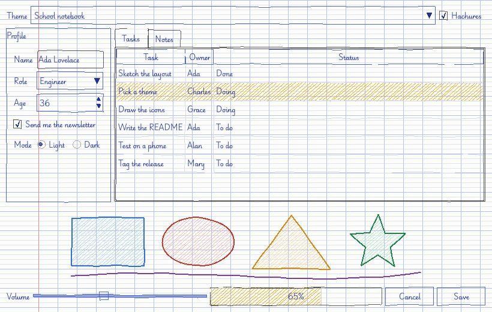
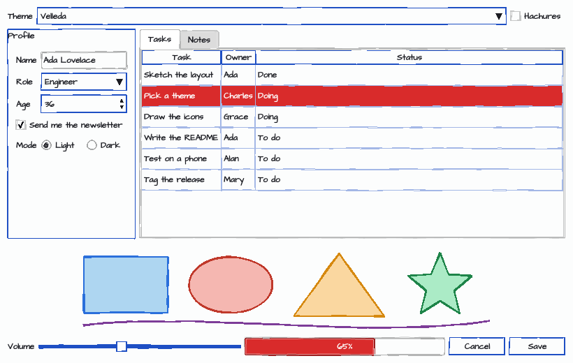
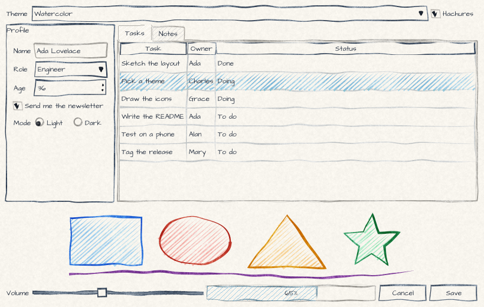
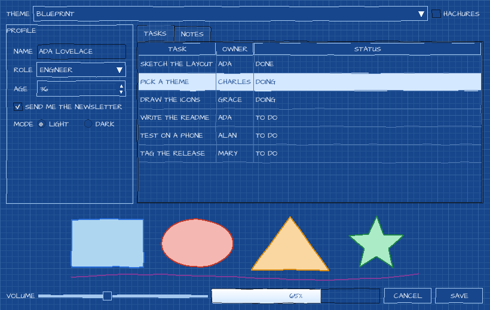
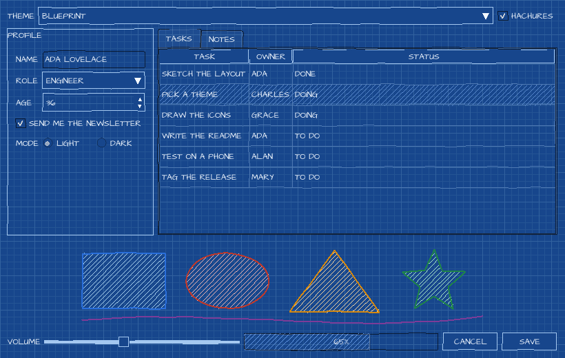
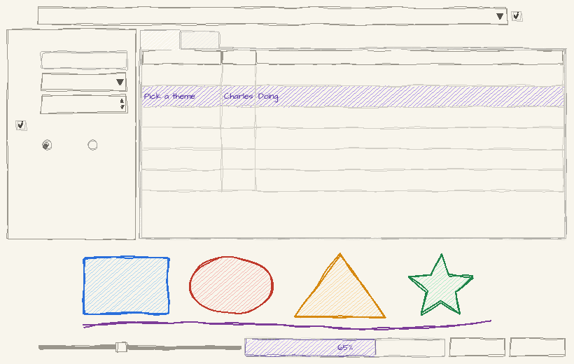
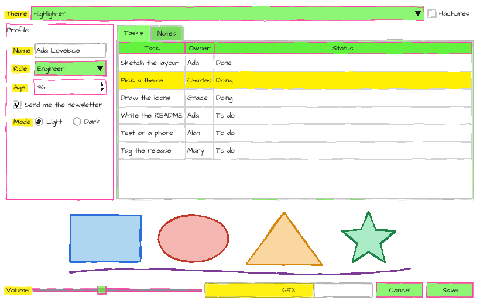

# Hand Painting for Qt

[](https://github.com/qnope/HandPaintingForQt/actions/workflows/ci.yml)
[](https://qnope.github.io/HandPaintingForQt/)
[](https://github.com/qnope/HandPaintingForQt/releases)
[](LICENSE)

Hand-drawn themes for Qt widgets, à la [Rough.js](https://roughjs.com). One call gives a window
and every widget in it the look of a pencil sketch, of chalk on a slate, of watercolor or of a
blueprint. The widgets keep their behavior, and what your own code paints with `QPainter` is
drawn by hand too.

**Try it in your browser: https://qnope.github.io/HandPaintingForQt/**


- [Features](#features)
- [Quick start](#quick-start)
- [Themes](#themes)
- [Use hpq in your project](#use-hpq-in-your-project)
- [Examples](#examples)
- [API overview](#api-overview)
- [Build from source and run the tests](#build-from-source-and-run-the-tests)
- [Versions and changelog](#versions-and-changelog)
- [License](#license)

## Features

- **Nine themes**, each with a solid or a hatched fill: sketch, China ink, black slate and
  chalk, school notebook, Velleda, watercolor, blueprint, invisible ink and highlighter.
- **The standard widgets**: buttons, check boxes, radio buttons, line edits, combo boxes, spin
  boxes, sliders, scroll bars, progress bars, tabs, group boxes, tables, trees, headers, and
  the menus, dialogs, tooltips and lists that open as windows of their own.
- **Your own painting**: the `paintEvent` of your widgets and the items of a `QGraphicsScene`
  are hand-drawn with the theme, without a change to their code.
- **A steady hand**: a shape keeps its wobble between repaints and when a view scrolls. A
  geometry engine with a fixed seed draws the same window every time.
- **Fast repaints**: the rough paths of the shapes are kept between repaints, and a repaint of
  a part of a window (a hovered button, the cursor of a field) draws only what is close to it.
- **Fonts included**: the handwritten fonts of the themes are embedded in the library.
- **Everywhere Qt runs**: a shared library on Windows (MSVC), Linux (gcc, clang) and macOS
  (clang), a static one with Qt for WebAssembly.
- **Easy to integrate**: the CMake target `hpq::hpq`, from `find_package`, `FetchContent` or
  `add_subdirectory`.

## Quick start

```cpp
#include <hpq/RoughGeometryEngine.h>
#include <hpq/SketchTheme.h>
#include <hpq/Theming.h>
#include <hpq/WindowTheming.h>

#include <QApplication>

int main(int argc, char *argv[]) {
    QApplication application(argc, argv);
    MyWindow window;

    const hpq::Theme theme = hpq::sketch_theme();  // or sketch_theme(hpq::FillStyle::Hachure)
    const auto geometry_engine = std::make_shared<const hpq::RoughGeometryEngine>();

    // The window and every widget in it.
    hpq::apply_theme(window, theme, geometry_engine);

    // Menus, dialogs and tooltips are windows of their own: this event filter gives them the
    // theme when they open.
    hpq::WindowTheming window_theming(theme, geometry_engine);
    application.installEventFilter(&window_theming);

    window.show();
    return application.exec();
}
```

```cmake
target_link_libraries(MyApplication PRIVATE hpq::hpq)
```

`apply_theme` themes the widgets the window has: call it once they are built (after
`setupUi`), and again after you add widgets. Calling it with another theme switches the theme;
`hpq::remove_theme(window)` gives the window back its original look.

## Themes

Each theme is a function of the library, in its own header, that takes the fill style:
`hpq::FillStyle::Solid` (the default) or `hpq::FillStyle::Hachure`.

| Theme | Solid | Hachures |
| --- | --- | --- |
| **Sketch**<br>`sketch_theme`<br>`<hpq/SketchTheme.h>`<br><br>Graphite pencil on paper. |  |  |
| **China ink**<br>`china_ink_theme`<br>`<hpq/ChinaInkTheme.h>`<br><br>A brush loaded with ink on rice paper, and the red of a seal for the selection. |  |  |
| **Black slate and chalk**<br>`slate_theme`<br>`<hpq/SlateTheme.h>`<br><br>White and colored chalk on a black slate. |  |  |
| **School notebook**<br>`notebook_theme`<br>`<hpq/NotebookTheme.h>`<br><br>A fountain pen on the Seyès ruled paper of a French school notebook. |  |  |
| **Velleda**<br>`velleda_theme`<br>`<hpq/VelledaTheme.h>`<br><br>Dry-erase markers on a white board. |  |  |
| **Watercolor**<br>`watercolor_theme`<br>`<hpq/WatercolorTheme.h>`<br><br>Washes and brush lines on a grainy paper. |  |  |
| **Blueprint**<br>`blueprint_theme`<br>`<hpq/BlueprintTheme.h>`<br><br>White ink on the blue paper of an architect, with a faint grid. |  |  |
| **Invisible ink**<br>`invisible_ink_theme`<br>`<hpq/InvisibleInkTheme.h>`<br><br>The text shows only where it is selected, under the violet light of a lamp. |  |  |
| **Highlighter**<br>`highlighter_theme`<br>`<hpq/HighlighterTheme.h>`<br><br>Fluorescent highlighters over notes in black pen. |  |  |

The images are the window of [`Examples/Integration`](Examples/Integration), rendered by
[`tools/screenshots`](tools/screenshots/ThemeScreenshots.cpp):
`QT_QPA_PLATFORM=offscreen build/tools/screenshots/HpqThemeScreenshots docs/images`. The CI
renders them on Linux for each pull request (artifact `theme-screenshots`).

## Use hpq in your project

Requirements: Qt 6 with the Widgets module (the CI uses Qt 6.8; Qt 6.4 works too), a C++17
compiler and CMake 3.16 or newer.

In the three ways below, your application links the same target, `hpq::hpq`, which brings the
headers, C++17 and `Qt6::Widgets`:

```cmake
find_package(Qt6 REQUIRED COMPONENTS Widgets)
# ... get hpq in one of the three ways below ...
qt_add_executable(MyApplication main.cpp)
target_link_libraries(MyApplication PRIVATE Qt6::Widgets hpq::hpq)
```

[`Examples/Integration`](Examples/Integration/CMakeLists.txt) is a complete application that
does it in each of the three ways; the CI builds and runs it on every platform.

### With FetchContent

CMake downloads the release and builds hpq with your application:

```cmake
include(FetchContent)
FetchContent_Declare(HandPaintingForQt
  GIT_REPOSITORY https://github.com/qnope/HandPaintingForQt.git
  GIT_TAG v0.1.0
  GIT_SHALLOW TRUE)
FetchContent_MakeAvailable(HandPaintingForQt)
```

As a subproject, HandPaintingForQt builds only the library: its tests, examples and tools are
off, and it does not need GoogleTest. To build it from a copy you already have, configure with
`-DFETCHCONTENT_SOURCE_DIR_HANDPAINTINGFORQT=<path of the copy>`.

### With add_subdirectory

With a copy of the repository in your project, as a git submodule for instance:

```cmake
add_subdirectory(external/HandPaintingForQt)
```

### With find_package, after an install

Build and install hpq once:

```sh
cmake -S HandPaintingForQt -B build/hpq -DCMAKE_BUILD_TYPE=Release \
      -DHPQ_BUILD_TESTS=OFF -DHPQ_BUILD_EXAMPLES=OFF -DCMAKE_PREFIX_PATH=<qt>
cmake --build build/hpq --config Release
cmake --install build/hpq --config Release --prefix <prefix>
```

Then find it in your project, with `<prefix>` in `CMAKE_PREFIX_PATH`
(`-DCMAKE_PREFIX_PATH="<prefix>;<qt>"`):

```cmake
find_package(HandPaintingForQt 0.1 REQUIRED)
```

The package finds Qt itself. Before 1.0, `find_package(HandPaintingForQt 0.1)` accepts the
versions 0.1.x only: a minor version may change the API.

The install holds:

| Path | Content |
| --- | --- |
| `include/hpq/` | The headers, with the generated `hpq/Version.h` |
| `lib/libhpq.so.0.1.0`, `lib/libhpq.0.1.0.dylib`, `bin/hpq.dll` and `lib/hpq.lib` | The library (`hpqd.dll` and `hpqd.lib` in Debug with MSVC: a Debug and a Release build can share a prefix) |
| `lib/cmake/HandPaintingForQt/` | The CMake package: `HandPaintingForQtConfig.cmake`, its version file and the target `hpq::hpq` |
| `share/doc/HandPaintingForQt/` | The license of hpq and those of its fonts |

On Linux, the installed library finds Qt where it was linked with it (its RPATH).

### On Windows

Windows has no RPATH: the application loads `hpq.dll` from its own directory or from `PATH`.
Copy it next to the executable after the build, as `Examples/Integration` does:

```cmake
if(WIN32)
  add_custom_command(TARGET MyApplication POST_BUILD
    COMMAND ${CMAKE_COMMAND} -E copy_if_different $<TARGET_FILE:hpq::hpq> $<TARGET_FILE_DIR:MyApplication>
    VERBATIM)
endif()
```

With `FetchContent` or `add_subdirectory`, setting `CMAKE_RUNTIME_OUTPUT_DIRECTORY` in your
project also builds `hpq.dll` in the directory of your executables. To ship the application,
`windeployqt` copies Qt next to it.

### On macOS with Qt 6.8 and Xcode 26

Not an issue of hpq, but one you may meet: Qt 6.8 links the AGL framework, which the macOS SDK
of Xcode 26 no longer has, and the link fails with `framework 'AGL' not found`. Before
`find_package(Qt6)`, link the OpenGL framework in its place, as this project and
`Examples/Integration` do:

```cmake
if(APPLE)
  execute_process(COMMAND xcrun --show-sdk-path
    OUTPUT_VARIABLE sdk OUTPUT_STRIP_TRAILING_WHITESPACE ERROR_QUIET)
  if(NOT EXISTS "${sdk}/System/Library/Frameworks/AGL.framework")
    set(WrapOpenGL_AGL "-framework OpenGL")
  endif()
endif()
```

### Options

| Option | Default | Effect |
| --- | --- | --- |
| `HPQ_BUILD_TESTS` | `ON`, `OFF` in a subproject | The tests (GoogleTest, from vcpkg) |
| `HPQ_BUILD_EXAMPLES` | `ON`, `OFF` in a subproject | The example application and the screenshot tool |
| `HPQ_INSTALL` | `ON` | The install rules and the CMake package |
| `HPQ_BUILD_BENCH` | `OFF` | The repaint benchmark ([`bench`](bench/README.md)), with the examples |

### Version

`<hpq/Version.h>` gives the version the code is compiled with (`HPQ_VERSION_MAJOR`,
`HPQ_VERSION_MINOR`, `HPQ_VERSION_PATCH`, `HPQ_VERSION_STRING`), and `hpq::version()`
(`<hpq/Hpq.h>`) the version of the library loaded at run time.

## Examples

- [`Examples/Integration`](Examples/Integration): a small application, a separate CMake project
  as yours is, with a gallery of widgets and of shapes painted in `paintEvent`, and a combo box
  to change the theme. `GALLERY_HPQ_SOURCE` chooses how it gets hpq: `find_package` (the
  default), `FetchContent` or `add_subdirectory`.

  ```sh
  cmake -S Examples/Integration -B build/gallery -DGALLERY_HPQ_SOURCE=add_subdirectory -DCMAKE_PREFIX_PATH=<qt>
  cmake --build build/gallery
  ```

- [`Examples`](Examples): the example application of the repository, built with it, and the
  one that runs in the browser: a table, a tree, a `QGraphicsScene` of shapes, menus and a
  dialog.

## API overview

All of hpq is in the namespace `hpq`.

- **Themes**: `sketch_theme`, `china_ink_theme`, `slate_theme`, `notebook_theme`,
  `velleda_theme`, `watercolor_theme`, `blueprint_theme`, `invisible_ink_theme` and
  `highlighter_theme` each return a `Theme`.
- **`apply_theme(window, theme, geometry_engine)`** and **`remove_theme(window)`**
  (`<hpq/Theming.h>`): theme a window and its widgets, or give them back their look. A theme is
  a palette and a font, a `HandPaintStyle` on each widget and a `HandPaintEffect` on the window.
- **`WindowTheming`** (`<hpq/WindowTheming.h>`): the event filter that themes the menus,
  dialogs and tooltips of the application.
- **`Theme`** (`<hpq/Theme.h>`): make a theme of your own from a `QPalette`, a `QFont`,
  `RoughOptions` (roughness, number of strokes, largest offset, gap and angle of the hachures),
  a `FillStyle`, a `Medium` (`Pencil`, `Chalk`, `Ink` or `Watercolor`), a `TextInk` (`Visible`
  or `Invisible`) and the marker of the labels.
- **`GeometryEngine`** and **`RoughGeometryEngine`** (`<hpq/RoughGeometryEngine.h>`): how
  shapes are made rough. `RoughGeometryEngine()` takes a random seed, each engine has its own
  hand; `RoughGeometryEngine(seed)` draws the same paths every time. Derive from
  `GeometryEngine` for another look.
- **`HandPaintDevice`** (`<hpq/HandPaintDevice.h>`): hand-paint what a `QPainter` draws,
  outside of the widgets, on a `QImage` for instance:

  ```cpp
  QImage image(400, 300, QImage::Format_ARGB32_Premultiplied);
  image.fill(Qt::white);
  QPainter target(&image);
  const hpq::Theme theme = hpq::sketch_theme();
  const hpq::RoughGeometryEngine geometry_engine;
  hpq::HandPaintDevice device(target, theme, geometry_engine);
  QPainter painter(&device);
  painter.drawEllipse(50, 50, 300, 200);
  ```

- **`HandPaintEffect`** (`<hpq/HandPaintEffect.h>`): the `QGraphicsEffect` that hand-paints a
  widget and its children, for a single widget.

## Build from source and run the tests

With Qt, and vcpkg next to the repository (`../vcpkg`) for GoogleTest:

```
cmake -S . -B build -DCMAKE_TOOLCHAIN_FILE=../vcpkg/scripts/buildsystems/vcpkg.cmake -DCMAKE_PREFIX_PATH=<qt>
cmake --build build --config Debug
ctest --test-dir build -C Debug --output-on-failure
```

Or define them in a local `CMakeUserPresets.json` and use `cmake --preset debug`,
`cmake --build --preset debug`, `ctest --preset debug`.

The local presets use the Ninja generator (`build/debug`, Debug). The `release` preset builds in `build/release`: `cmake --preset release`, `cmake --build --preset release`, `ctest --preset release`. Without presets, add `-G Ninja` to the first command.

### Shared library

`hpq` is built as a shared library (`hpq.dll`, `libhpq.so`, `libhpq.dylib`). Only what its headers mark with `HPQ_EXPORT` (`hpq/Export.h`) is visible outside it: its public classes and functions.

On Linux and macOS the executables of the build find the library by RPATH. Windows has no RPATH, so `hpq.dll` and the executables are all built in `build/bin` there.

With Qt for WebAssembly, which is static, `hpq` stays a static library.

### WebAssembly

The example application also builds with Qt for WebAssembly. With the Emscripten release matching the Qt version activated (3.1.56 for Qt 6.8):

```
cmake -S . -B build/wasm -DCMAKE_BUILD_TYPE=Release -DCMAKE_TOOLCHAIN_FILE=<qt>/wasm_singlethread/lib/cmake/Qt6/qt.toolchain.cmake -DQT_HOST_PATH=<qt>/gcc_64 -DHPQ_BUILD_TESTS=OFF
cmake --build build/wasm
```

`build/wasm/Examples` then holds the site: `index.html` (from `Examples/web`), `HandPaintingExample.js`, `HandPaintingExample.wasm`, `qtloader.js` and `fonts`. Serve it over HTTP, for instance `python3 -m http.server -d build/wasm/Examples`.

`HPQ_BUILD_TESTS=OFF` leaves the tests, and so GoogleTest, out of the build.

The example is linked with asyncify (`-sASYNCIFY -Os`, in `Examples/CMakeLists.txt`), so that calls reentering the event loop, such as `QDialog::exec()` or `QMenu::exec()`, return as they do on the desktop. It makes the `.wasm` file larger; `open()` and `show()` need no asyncify.

On a phone, Qt opens the virtual keyboard by giving the focus to a text field it keeps hidden in the page. `index.html` keeps the browser from moving this focus after a tap, which closed the keyboard at once in Safari on iOS, and switches off the corrections of the keyboard in this field, which Qt does not follow. A double tap on a cell of the table or of the tree opens its editor without a tap on the editor itself, so Qt does not ask for the keyboard: `ItemEditorInputPanel` (`Examples/src`) asks for it when the tap is released.

The `Pages` workflow (`.github/workflows/pages.yml`) does this build, checks with `.github/scripts/WasmSmokeTest.cjs` that the application starts in a browser, with `.github/scripts/WasmMobileInputTest.cjs` that text can be typed in the line edit and in a cell of the table in a browser emulating a phone and, on `main`, deploys the site to GitHub Pages. The repository setting Pages > Build and deployment > Source must be "GitHub Actions".

## Versions and changelog

hpq follows [Semantic Versioning](https://semver.org): before 1.0, a minor version (0.1 to
0.2) may change the API and the ABI, a patch version does not. The changes of each version are
in [CHANGELOG.md](CHANGELOG.md).

To publish a version: set it in `project()` (`CMakeLists.txt`) and in `vcpkg.json`, move the
changes of `[Unreleased]` to its section in `CHANGELOG.md` (the `HpqVersionsAgree` test checks
that the three agree), merge, then push the tag `v<version>`. The `Release` workflow
(`.github/workflows/release.yml`) creates the GitHub release with the notes of the changelog.

## License

Hand Painting for Qt is under the [MIT license](LICENSE).

The fonts embedded in the library are under the [SIL Open Font License 1.1](hpq/resources/fonts):
[Architects Daughter](hpq/resources/fonts/OFL.txt),
[Playwrite FR Moderne](hpq/resources/fonts/OFL-PlaywriteFRModerne.txt) and
[Kaushan Script](hpq/resources/fonts/OFL-KaushanScript.txt).
